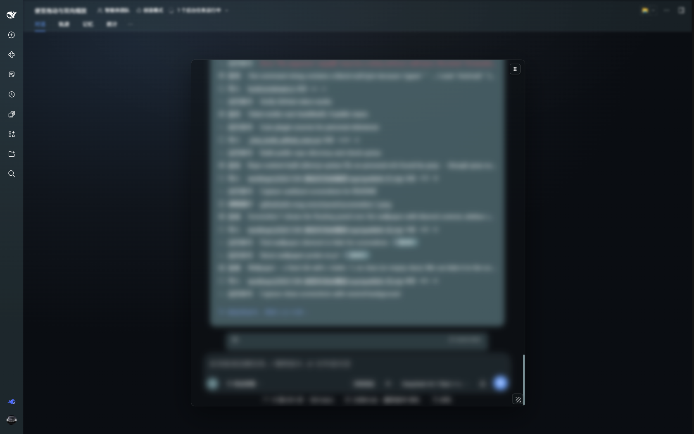
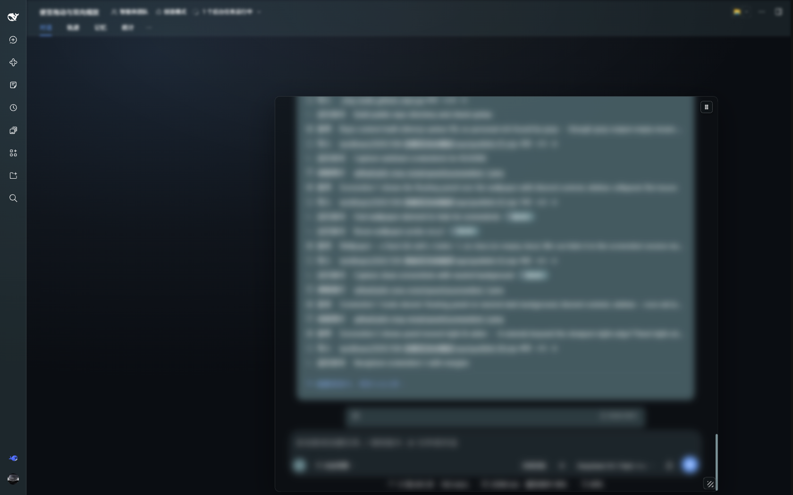
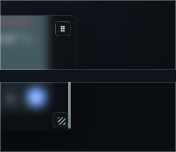

# DSH 消息区自由缩放 · 把对话区变成你自己的浮窗

> 拖动改大小、拖动搬位置，位置和尺寸自动记住 —— DSH（DeepSeek Harness）的界面 / 皮肤主题类小插件。





*（截图里的对话正文做了模糊处理；壁纸换成中性渐变，方便看清插件本身。）*

---

## 这是什么

DSH 的对话区默认是一条居中、固定宽度的消息列，输入框跟在下面。这个插件把**整块对话（消息区 + 输入框）变成一个浮窗**：

- **右下角 ⤡**：拖动改宽、改高（最小 460×320）
- **右上角 ⠿**：拖动把整块搬到任意位置
- **双击**各自复位；键盘聚焦把手后 ←→↑↓ 微调（Shift 大步）
- 位置和尺寸存 `localStorage`，刷新、重开都还在
- 活动范围限在**对话内容窗格内**（内缩 8px）：不会挡住左侧栏、不会跑出屏幕；收起左侧栏后可以继续往左贴
- 输入框宽度跟着面板走、高度不变、始终贴面板下沿
- 窄屏（< 720px）自动撤下，不动手机布局



## 安装

DSH 插件以 Cordis 条目加载。本插件是**纯前端（Client）插件**，Host 半是空占位，不需要重启宿主即可热加载。

1. 把仓库放到本机任意位置，例如 `D:\plugins\dsh-msg-resize`
2. 链接到你想装的那个 profile 的 `node_modules`（Windows 用 junction，macOS/Linux 用 symlink）：

```bat
mklink /J "%DSH_HOME%\profiles\web\node_modules\dsh-msg-resize" "D:\plugins\dsh-msg-resize"
```

```bash
ln -s /path/to/dsh-msg-resize "$DSH_HOME/profiles/web/node_modules/dsh-msg-resize"
```

3. 在该 profile 的 `cordis.patch.yml` **末尾**追加：

```yaml
- insert:
    - id: msg-resize
      name: 'dsh-msg-resize'
```

4. 等宿主重组合（约 7–10 秒），或重启 DSH 一次。打开任意会话，右侧应出现一个浮窗和两个把手。

> `DSH_HOME` 默认是 dsh 的数据目录（Windows 常见为 `F:\dsh-home` 或 `%USERPROFILE%\.dsh`）。
> 只装 web profile 就只动 web 的 `cordis.patch.yml`，桌面版 profile 不受影响。

## 使用

| 想做 | 操作 |
|---|---|
| 改大小 | 拖右下角 **⤡**（横改宽、竖改高） |
| 搬位置 | 拖右上角 **⠿** |
| 回到默认 | 双击对应的把手 |
| 微调 | 点一下把手聚焦，然后 ←→ 改宽、↑↓ 改高（Shift ×4） |

## 兼容性 & 已知限制

- 验证环境：DSH web 端 `0.2.x`（Chromium / Electron），插件 v2.6.0。
- 靶点全部用 CSS Modules 的**类名后缀**匹配（`[class$="_scrollBody"]`、`[class$="_column"]`、`[class$="_centerCol"]` 等），跨构建稳定；但宿主若大改对话区结构，插件会**自动失效不报错**（fail-inert），届时改这几处选择器即可。
- 面板是 `position: fixed`，宿主祖先节点不能有 `transform / filter`（当前版本没有；若将来加了，fixed 会被劫持，需要换成 portal）。
- 与 **dsh-chat-drag** 的关系：那个插件负责「把消息区横向挪一挪」，它的把手和本插件的把手会撞位。所以本插件在**对话页**接管移动（把它的位移归零并隐藏它的把手），**新建会话页**不受影响。若你没装 dsh-chat-drag，这段逻辑等于空转。
- 折叠左侧栏、切换「便签 / 对话」面板后，活动范围会自动重算；拖动到边界附近不会抖动（v2.6 专门修过）。

## 卸载

1. 删掉 `cordis.patch.yml` 里那段 `- insert: … msg-resize`；
2. 删掉 `node_modules\dsh-msg-resize` 链接（若把仓库 clone 在别处，仓库本身也可以删）；
3. 刷新页面。插件在 `localStorage` 只留一个键 `dshMsgResize.v2`，可顺手清掉。

## 实现要点（给想改代码的人）

- **容器**：`[class$="_scrollBody"]` 是真正的对话滚动容器，改成 `position: fixed` 后消息区和输入框一起搬，内部滚动照常、输入框仍是 sticky。
- **宽度要改两处**：消息列 `[class$="_column"]` 与输入卡 `[class*="_composerStack"] [class$="_card"]` 不在同一容器，差的 32px 是输入卡内边距。
- **测量纪律**：运行期绝不清空自己的样式表去「量自然布局」——那会让宿主重排，拖拽时表现为来回跳。只在启动时量一次窗格顶，其余实时算。
- **拖动**：按下时冻结边界，move 里只做钳制；位置没变就不重写样式表。
- **多实例自愈**：热更新后旧实例靠全局代际号 `__dshMsgResizeGen` 自停。

详细版本史与踩坑记录见仓库 [CHANGELOG.md](CHANGELOG.md)。

## English (short)

A tiny DSH UI plugin that turns the chat area into a draggable, resizable floating window:
drag the ⤡ handle (bottom-right) to resize, drag the ⠿ handle (top-right) to move, double-click to reset.
Position/size persist in `localStorage`; movement is clamped to the conversation pane.

Install: link the folder into `$DSH_HOME/profiles/<profile>/node_modules/dsh-msg-resize`,
append the `- insert: - id: msg-resize / name: 'dsh-msg-resize'` block to that profile's `cordis.patch.yml`,
then restart DSH (or wait for the host to recompose). Verified on DSH web 0.2.x.

## License

MIT
